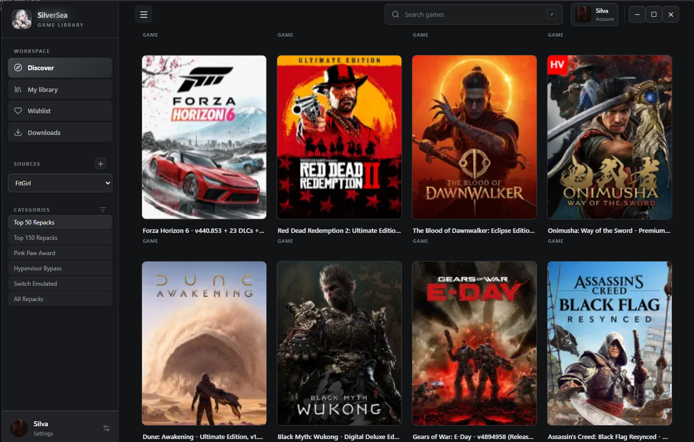
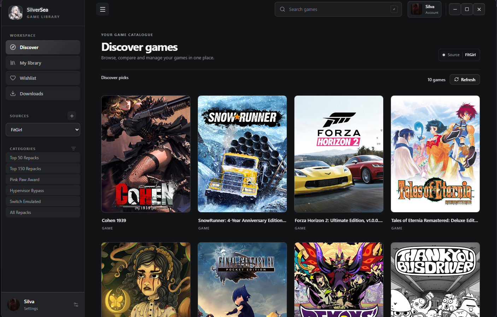
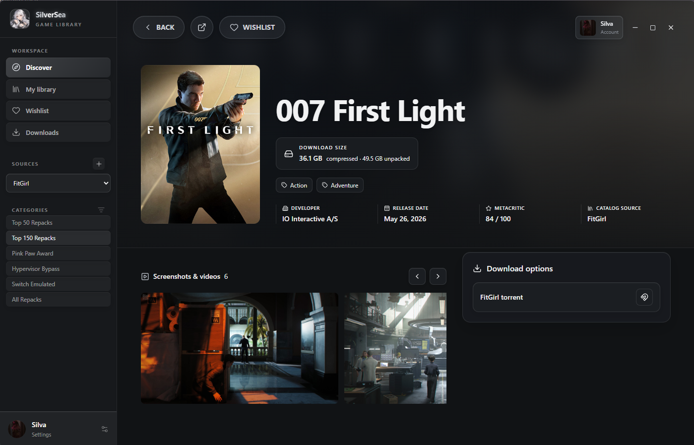
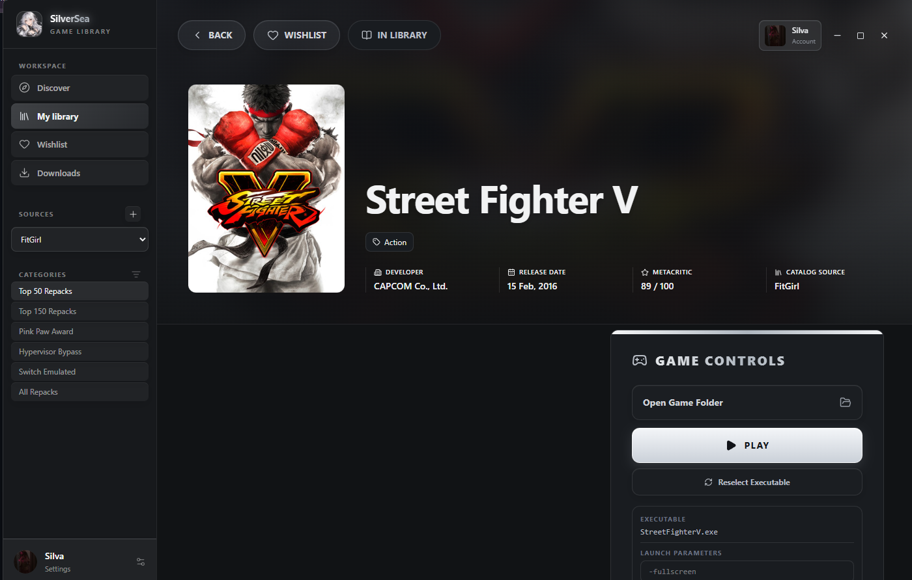
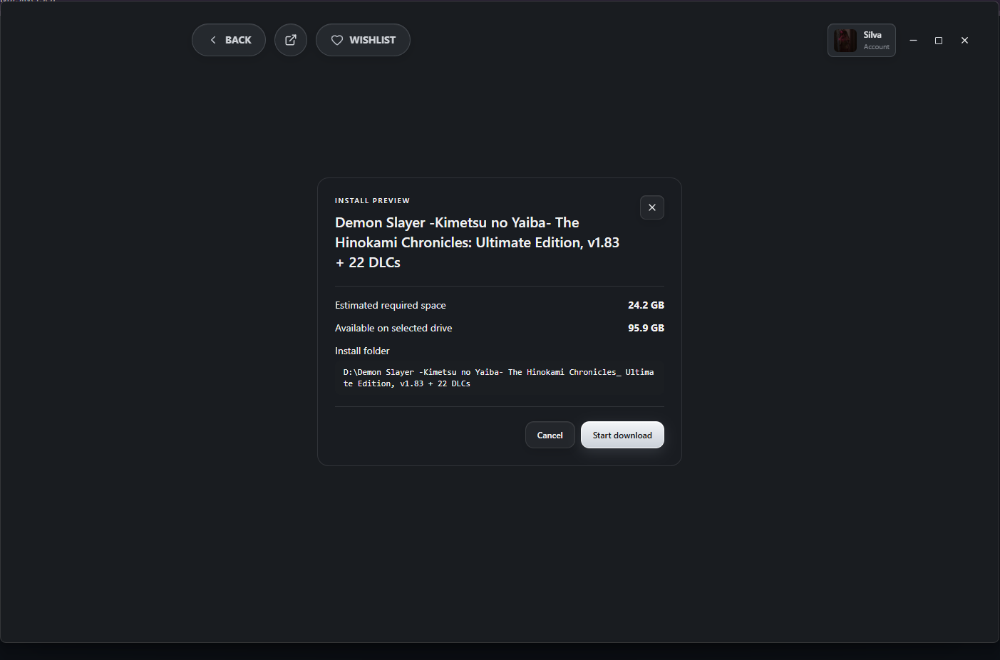
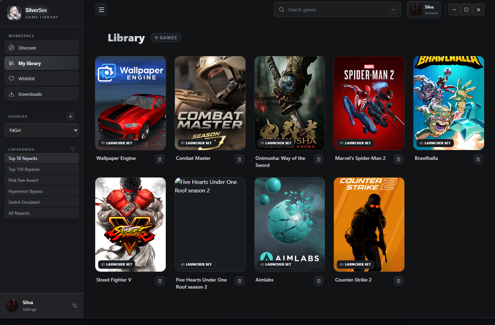
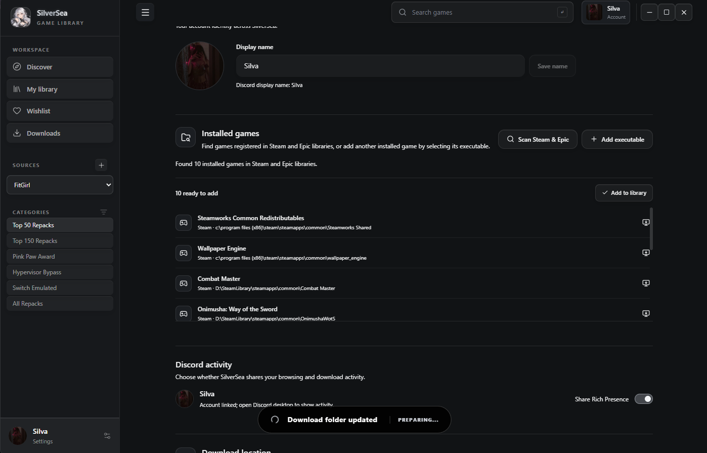
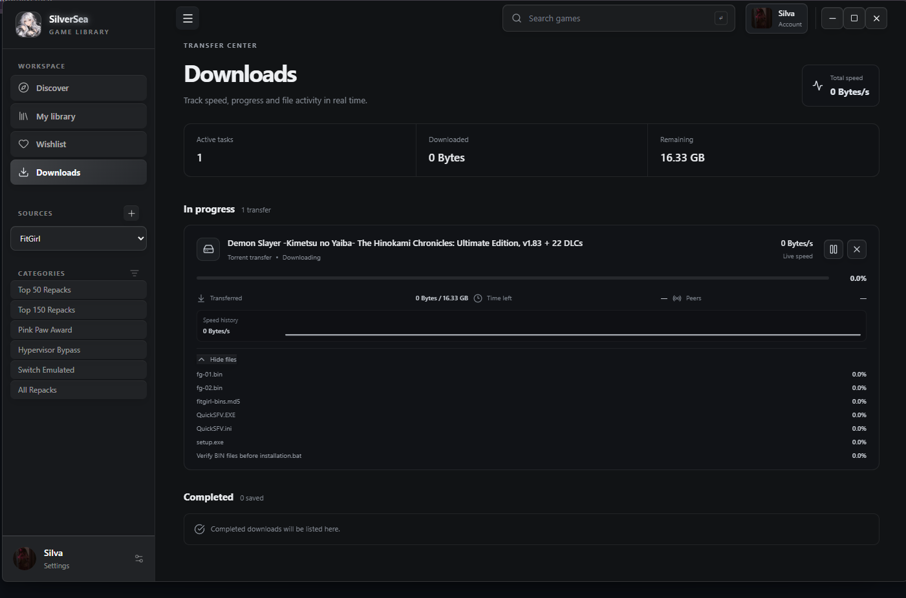

# SilverSea

SilverSea brings your game catalogue, library, and downloads together in one desktop app.

## Download for Windows

[Download SilverSea Setup](https://github.com/8bitsilva/SilverSea/releases/latest/download/SilverSea-Setup.exe)

Open **SilverSea-Setup.exe**, choose where to install the app, and follow the prompts. When setup is finished, start SilverSea from your desktop or Start menu.

You can also download and open the latest setup from PowerShell:

```powershell
$installer = Join-Path $env:TEMP 'SilverSea-Setup.exe'; irm 'https://github.com/8bitsilva/SilverSea/releases/latest/download/SilverSea-Setup.exe' -OutFile $installer; Start-Process $installer
```

## What you can do

- Browse games and view their details, screenshots, and download options.
- Choose where a game will be installed and check the available disk space before downloading.
- Follow download progress and speed in the Downloads page.
- Keep your games together in your library, including games already installed on your PC.
- Launch supported installed games from SilverSea.
- Connect Discord to sync your profile and share your current SilverSea activity.
- Check for app updates from Profile settings.

Closing the app window keeps SilverSea in the system tray so downloads can continue. Choose **Quit and save downloads** from the tray menu when you want to fully close the app.

## Need help?

If setup or a download does not work, open an issue in the [SilverSea project](https://github.com/8bitsilva/SilverSea/issues) and include what happened and which version you are using.

## Screenshots

See SilverSea in action:

### Discover





### Game details and install







### Your games





### Downloads



